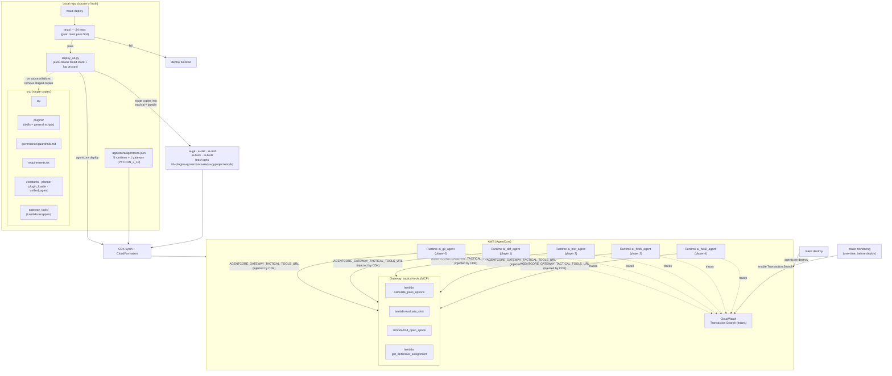

# Deployment Architecture

`make deploy` runs the test gate, then stages shared code into each agent bundle
and deploys everything (5 runtimes + gateway + 4 Lambda tools) in one CDK stack.
`deploy_all.py` auto-cleans any failed stack and orphaned log groups first, so
re-running is always safe.

