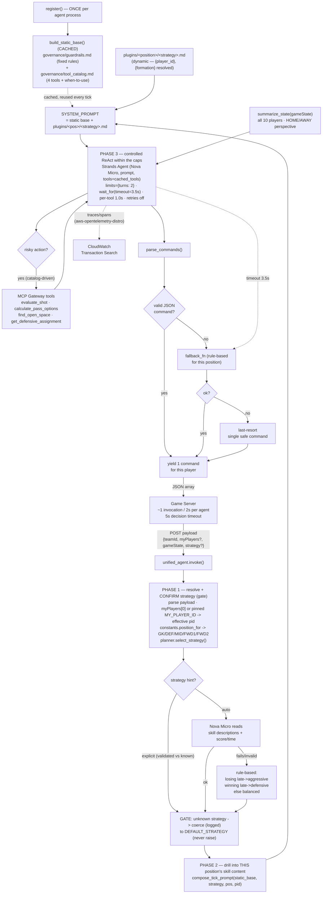

# Per-Tick Agent Workflow

What happens on every game tick, for every one of the 5 agents. The game server
invokes each agent independently (~1 call / 2s, 5s decision timeout).

> Keep this document accurate to the implemented code. It mirrors
> `src/agents/players/unified_agent.py` (the 3-phase flow),
> `src/agents/players/plugin_loader.py` (the static/dynamic prompt split), and
> `src/agents/players/constants.py` (the 3.5s timeout and 2-iteration cap). If
> the code changes, update this file in the same change.

## Static vs dynamic prompt (built once vs per tick)

The system prompt is split into two layers:

- **STATIC base — built ONCE per agent process at `register()`, then cached.**
  `plugin_loader.build_static_base()` = the game guardrails
  (`src/governance/guardrails.md`, rules unchanged) + the tactical-tool catalog
  (`src/governance/tool_catalog.md`). It is strategy- and position-agnostic, so
  it never changes across ticks and is NOT recomposed inside `invoke()`.
  The tool catalog names exactly the four deployed tactical tools and the
  situation that triggers each — it is what makes the model *aware* of the tools
  and *when* to consult them. The tools themselves still execute via the Strands
  `tools=` native tool-calling mechanism.

- **DYNAMIC strategy content — composed per tick, AFTER the strategy is decided.**
  Once the planner has settled the team strategy, the agent consults that
  strategy's body for its OWN resolved position
  (`src/plugins/<position>/<strategy>.md`) and `plugin_loader.compose_tick_prompt()`
  appends it to the cached static base. This is a single string join plus the
  existing `{player_id}`/`{formation}` substitution — no network.

## Settled calculation decision

All probability/advantage math is done by the **four existing MCP tactical tools
only** (`evaluate_shot`, `calculate_pass_options`, `find_open_space`,
`get_defensive_assignment`). There is **no code-interpreter / code-agent /
code-execution surface** and no new dependency — out of scope. The fix that makes
the agent "decide with facts" is the static tool catalog driving it to invoke the
right existing tool before a risky action, within the caps below.

## Markdown-only tuning promise (north-star)

Tactics live entirely in markdown. Adding a strategy is a drop-a-folder operation
with **zero Python change**: drop `src/plugins/strategies/<name>.md` (metadata)
plus `src/plugins/<position>/<name>.md` for all five positions, and the registry's
folder scan makes it planner-selectable and loadable by every position. Improving
tactics is a markdown-only edit. Decide-with-facts is driven by the single static
`tool_catalog.md`, so a brand-new strategy with plain bodies (no tool wording)
still consults tools before risky actions.

## The controlled 3-phase per-tick flow

`unified_agent.invoke()` runs three explicit phases with a hard, logged gate
between PHASE 1 and PHASE 2 — skill content and tools are unreachable until a
concrete, known strategy is confirmed.

- **PHASE 1 — resolve position + CONFIRM strategy (the gate).** Parse the
  payload; take the effective player id from `myPlayers[0]` when present, else the
  pinned `MY_PLAYER_ID`; resolve the position via `constants.position_for`; call
  `planner.select_strategy`. A logged guard then **coerces (never asserts/raises)**
  an unknown strategy to `constants.DEFAULT_STRATEGY`, so a known name always flows
  on. Nothing downstream runs until this completes.
- **PHASE 2 — drill into this position's strategy skill content.** Only now does
  `compose_tick_prompt(static_base, strategy, pos, effective_pid)` append the
  dynamic body to the cached static base, and `summarize_state` builds the state
  text (HOME/AWAY perspective from `teamId`).
- **PHASE 3 — controlled ReAct within the caps.** Build the Strands Agent with
  `tools=cached_tools`, run it under `limits={"turns": MAX_TOOL_ITERATIONS}` (2) and
  `asyncio.wait_for(timeout=TICK_TIMEOUT_SECONDS)` (3.5s) over an executor. The agent
  consults the tactical MCP tools to decide with facts, then emits exactly one
  validated command.

## Where the caps apply

- `TICK_TIMEOUT_SECONDS = 3.5` — wall-clock budget enforced in PHASE 3 via
  `asyncio.wait_for`; on timeout the deterministic fallback runs.
- `MAX_TOOL_ITERATIONS = 2` — Strands per-invocation `limits={"turns": 2}` cap in
  PHASE 3; no unbounded loop is ever introduced.
- `PER_TOOL_TIMEOUT_SECONDS = 1.0` — each MCP tool is wrapped so one slow tool
  cannot eat the tick budget. Model retries are disabled (`max_attempts=1`).

